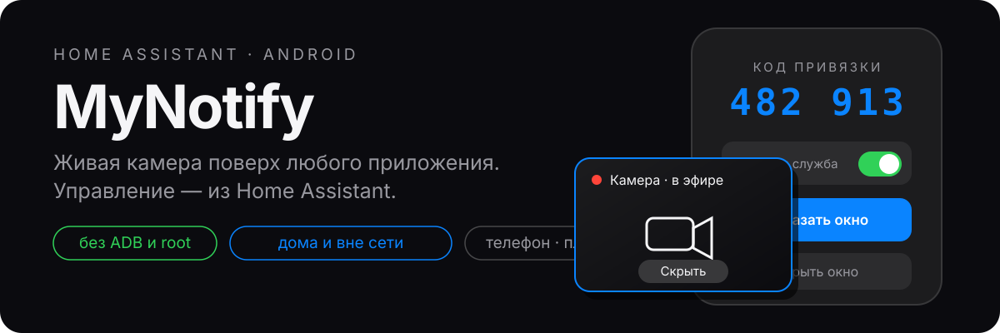
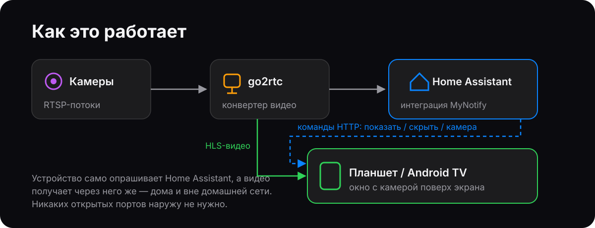
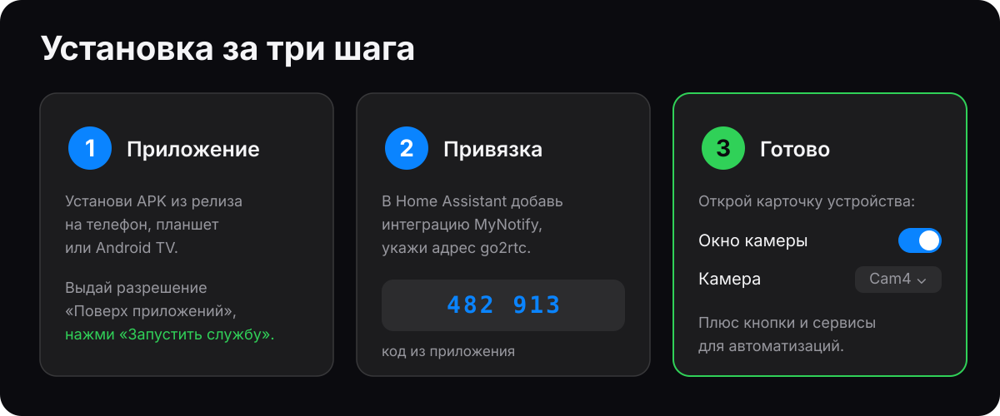
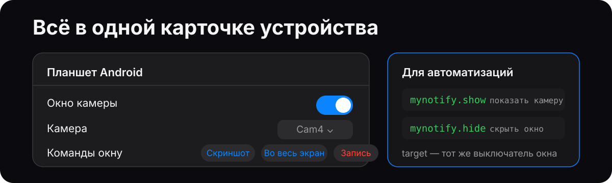

<p align="center">
  
</p>

<p align="center">
  <a href="https://my.home-assistant.io/redirect/hacs_repository/?owner=beemerspb&repository=mynotify&category=integration"></a>
  <a href="https://github.com/beemerspb/mynotify/releases/latest"></a>
  <a href="LICENSE"></a>
</p>

## Простыми словами

**MyNotify превращает любой Android-экран в монитор видеонаблюдения.** На
телефоне, планшете или Android TV поверх YouTube, фильма или рабочего стола
появляется плавающее окно с живой картинкой с камеры. Открыть, закрыть и
переключить камеру можно из Home Assistant — обычными переключателями и
автоматизациями.

- Окно показывает поток **go2rtc** (HLS) — работает с любыми камерами, которые
  уже подключены к Home Assistant через Frigate/go2rtc.
- **Без ADB, root и платных сервисов.** Приложение само подключается к Home
  Assistant по домашнему Wi-Fi.
- Наружу ничего не отправляется: всё живёт внутри домашней сети.

## Как это работает

<p align="center">
  
</p>

Приложение на устройстве — это фоновая служба. Она опрашивает Home Assistant,
какие команды ей выполнены: показать окно, скрыть, переключить камеру. Видео
окно берёт напрямую из go2rtc, поэтому картинка не дёргается, даже если HA
перезагружается. Привязка устройства — по 6-значному коду из приложения:
одна запись интеграции на один планшет/ТВ.

## Установка

<p align="center">
  
</p>

**Шаг 1 — приложение.** Скачай [APK из последнего релиза](https://github.com/beemerspb/mynotify/releases/latest)
и установи на Android-устройство (разреши установку из неизвестных источников).
Открой приложение → «Разрешить показ поверх приложений» → «Запустить службу».
Проверь, что адрес Home Assistant в поле «Адрес Home Assistant» верный, и
нажми «Сохранить адрес».

**Шаг 2 — интеграция.** В Home Assistant: *Настройки → Устройства и службы →
Добавление интеграции* → **MyNotify** → укажи адрес go2rtc
(например `http://homeassistant.local:1984`) → на шаге «Привязка устройства»
введи 6-значный код из приложения.

Если MyNotify не нашёлся в поиске — добавь репозиторий в маркетплейс/HACS:

- **HA 2026.11+**: *Marketplace → ⋮ → Добавить пользовательский репозиторий* →
  вставь `https://github.com/beemerspb/mynotify` (категория «Интеграции») →
  установи MyNotify → **перезапусти Core**.
- **HA до 2026.11 (HACS)**: *HACS → ⋮ → Пользовательские репозитории* → та же
  ссылка, категория «Интеграции» → установить → перезапустить Core.

**Шаг 3 — готово.** Открой карточку устройства MyNotify в Home Assistant.

## Что появляется в Home Assistant

<p align="center">
  
</p>

| Сущность | Название | Что делает |
| --- | --- | --- |
| `switch.mynotify_<устройство>_push` | Окно камеры | включить/выключить окно с выбранной камерой |
| `select.mynotify_<устройство>_kamera` | Камера | выпадающий список потоков go2rtc |
| `button…_skrinshot` | Скриншот | снимок экрана окна в галерею HA |
| `button…_na_ves_ekran` | На весь экран | свернуть/развернуть окно |
| `button…_zapis_video` | Запись видео | начать/остановить запись потока |
| сервис `mynotify.show` | — | показать конкретную камеру (+ автозакрытие) |
| сервис `mynotify.hide` | — | спрятать окно |

Шестерёнка на карточке интеграции — смена адреса go2rtc без переустановки.

## Автоматизации

Показывать камеру к датчику движения или звонку — как обычной службой:

```yaml
alias: Позвонили в дверь — камера на планшет
trigger:
  - trigger: state
    entity_id: binary_sensor.doorbell
    to: "on"
action:
  - action: mynotify.show
    data:
      target: switch.mynotify_<устройство>_push
      stream: Cam4        # имя потока go2rtc или полный http(s)-URL
      autohide: 30          # секунд; 0 — окно висит, пока не скроешь
```

Скрыть: `action: mynotify.hide` с тем же `target`. Выбор камеры из списка
`select` тоже показывает окно, если оно уже открыто, — и не открывает его
сам по себе.

Полное описание сервисов и частых ситуаций —
[deploy/ha-integration.md](deploy/ha-integration.md).

## FAQ

**Окно не появляется.** В приложении должна работать служба (зелёный тумблер
«Фоновая служба») и статус «Подключено». Проверь адрес HA в приложении и что
устройство не в режиме энергосбережения, убивающем фоновые процессы.

**Картинка стоит на одной камере.** Обнови интеграцию и приложение до одной
версии: номера версии у них общие, см. [CHANGELOG](CHANGELOG.md). После
обновления интеграции перезапусти Core.

**Обновился релиз, а маркетплейс предлагает старую версию.** Нажми
*Marketplace → ⋮ → Обновить список репозиториев* — HA кэширует репозитории.

**Планшет спал и «проспал» команды.** Не страшно: в очереди держится только
последняя команда показа, устаревшие отбрасываются. Проснулся — показалась
актуальная камера.

## Безопасность и приватность

- Обмен только внутри домашней сети (HTTP к вашему HA и go2rtc), без внешних
  серверов и телеметрии.
- Команды принимаются только устройством, привязанным 6-значным кодом;
  очередь команд живёт в памяти HA и не пишется на диск.
- Приложением нельзя управлять из интернета — только из вашего Home Assistant.

## Релизы

Каждый релиз — тег `v<версия>` с APK в аттачментах:
[github.com/beemerspb/mynotify/releases](https://github.com/beemerspb/mynotify/releases).
История изменений — [CHANGELOG.md](CHANGELOG.md).

## Лицензия

MIT — см. [LICENSE](LICENSE).
