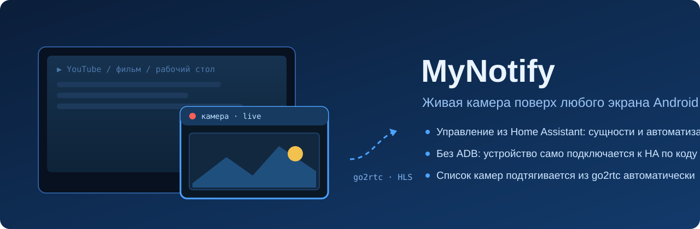

# MyNotify

**Камера поверх любого экрана.** Android-приложение (телефон / планшет /
Android TV) показывает плавающее окно с живым потоком go2rtc поверх YouTube,
фильма или рабочего стола. Управляет Home Assistant: обычные сущности,
автоматизации, сервисы. Без ADB и root.

[](https://my.home-assistant.io/redirect/hacs_repository/?owner=beemerspb&repository=mynotify&category=integration)
[](https://github.com/beemerspb/mynotify/releases/latest)

Текущая версия: **0.6.8** — приложение и интеграция одним номером,
история в [CHANGELOG](CHANGELOG.md).

## Что получаешь в Home Assistant

Каждое Android-устройство с приложением — это одна карточка устройства
со стандартными сущностями:

| Сущность | Что делает |
| --- | --- |
| `switch` «Показ окна» | включить/выключить оверлей с выбранной камерой |
| `select` «Камера» | выпадающий список потоков go2rtc (обновляется живьём) |
| `button` «Скриншот» / «На весь экран» / «Запись видео» | команды открытому окну |
| сервисы `mynotify.show` / `mynotify.hide` | показ с любой камеры + автоскрытие, для автоматизаций |
| «Настройки» (шестерёнка) | смена адреса go2rtc без переустановки |

## Как это устроено

- Приложение — фоновая служба. Оно **само** подключается к Home Assistant:
  регистрация по 6-значному коду + опрос очереди команд по HTTP.
  ADB, беспроводная отладка и сторонние интеграции не нужны.
- Привязка: при добавлении интеграции HA просит код, который показывает
  приложение на устройстве. Один планшет/ТВ = одна запись.
- Видео — HLS-поток go2rtc, проигрывается ExoPlayer'ом в плавающем окне.
- UI окна появляется по тапу (Закрыть / Во весь экран / Скриншот / Запись),
  сам скрывается через 6 с; кнопки масштабируются с размером окна;
  ресайз — перетаскивание за правый нижний угол.

## Быстрый старт

1. Поставь [APK релиза](https://github.com/beemerspb/mynotify/releases/latest)
   на планшет/ТВ, открой, выдай разрешение «Поверх приложений», нажми
   «Запустить службу». Проверь адрес Home Assistant в приложении и сохрани.
2. В HA: Настройки → Устройства и сервисы → Добавить интеграцию → MyNotify →
   адрес go2rtc → на шаге «Привязка устройства» введи 6-значный код из
   приложения.
3. Открой карточку устройства: тумблер окна, выбор камеры, кнопки.

## Установка интеграции

Ссылка репозитория для маркетплейса/HACS:

    https://github.com/beemerspb/mynotify

- **HA 2026.11+**: Настройки → Marketplace → «Добавить по ссылке» → вставить
  ссылку → установить → [добавить интеграцию](https://my.home-assistant.io/redirect/config_flow_start/?domain=mynotify).
- **HA до 2026.11 (HACS)**: HACS → ⋮ → «Пользовательские репозитории» →
  добавить ссылку (категория «Интеграции») → установить → добавить
  интеграцию.

## Автоматизации

```yaml
action: mynotify.show
data:
  target:
    entity_id: switch.mynotify_<устройство>_push
  stream: Cam4        # имя потока go2rtc или полный http(s)-URL
  autohide: 30        # секунд; 0 — не скрывать
```

Подробности и примеры — [deploy/ha-integration.md](deploy/ha-integration.md).

## Приватность

Всё работает только внутри домашней сети: приложение ходит по HTTP к вашему
HA и go2rtc, наружу ничего не отправляется, токены и пароли не сохраняются.
Привязка устройства — 6-значный код, действие команд ограничено LAN.

## Релизы

Каждый релиз = тег `v<версия>` с APK в аттачментах:
[github.com/beemerspb/mynotify/releases](https://github.com/beemerspb/mynotify/releases)
