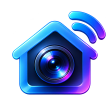
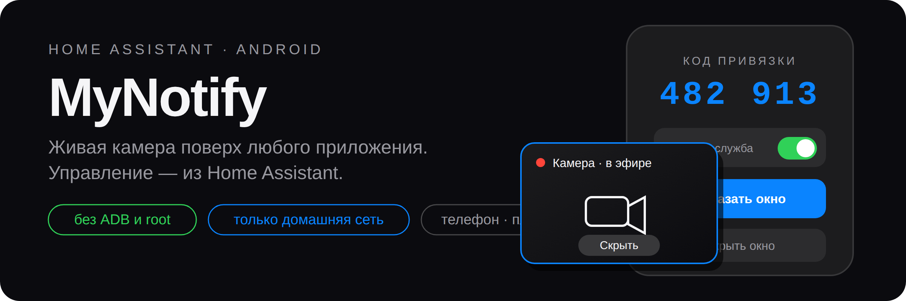
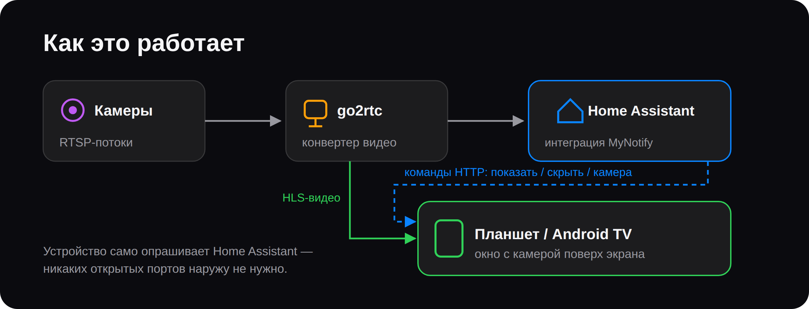
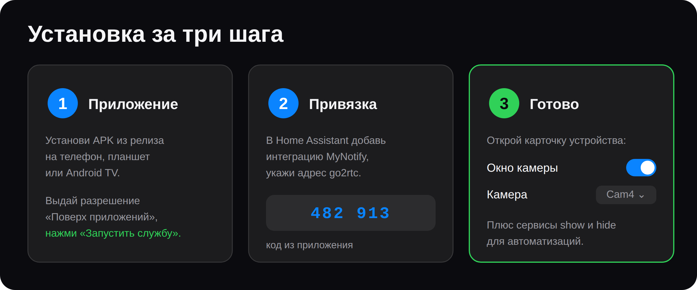
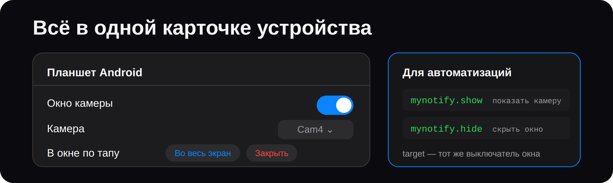

<p align="center">
  
</p>

<p align="center">
  
</p>

<p align="center">
  <a href="https://my.home-assistant.io/redirect/hacs_repository/?owner=beemerspb&repository=mynotify&category=integration"></a>
  <a href="https://github.com/beemerspb/mynotify/releases/latest"></a>
  <a href="LICENSE"></a>
</p>

Текущая версия — **0.7.22** (приложение и интеграция под одним номером,
история в [CHANGELOG](CHANGELOG.md)).

## Простыми словами

**MyNotify превращает любой Android-экран в монитор видеонаблюдения.** На
телефоне, планшете или Android TV поверх YouTube, фильма или рабочего стола
появляется плавающее окно с живой картинкой с камеры. Открыть, закрыть и
переключить камеру можно из Home Assistant — обычными переключателями и
автоматизациями.

- Окно показывает поток **go2rtc** (HLS) — работает с любыми камерами, которые
  уже подключены к Home Assistant через Frigate/go2rtc.
- **Без ADB, root и платных сервисов.** Приложение само подключается к Home
  Assistant по домашней сети.
- Наружу ничего не отправляется: серверов-посредников нет. Опциональный
  внешний адрес — это твой собственный HA (домен/Nabu Casa/Tailscale).
  Вне домашней сети видеопоток тоже идёт через HA (встроенный прокси) —
  публиковать go2rtc наружу не нужно.
- **Обновление без ручных скачиваний:** приложение само проверяет релизы
  на GitHub и устанавливает новую версию в один тап.
- **Прозрачность по вкусу:** один ползунок в настройках делает прозрачными
  сразу тёмный фон окна и видеопоток (0–100 %). Применяется на лету.
- **Чистое окно:** галочка «Не показывать кнопки в окне камеры» убирает панель
  иконок совсем. Кнопки при этом не теряются: ОК с пульта (или долгий тап)
  показывает панель принудительно, BACK закрывает окно.
- **Кино не прерывается:** когда открывается окно камеры, видео, которое сейчас
  играет, ставится на паузу, а при закрытии окна — снова запускается. Плюс
  «Пауза службы» на 5–120 минут: камера вообще не показывается, пока идёт
  фильм. Кнопка есть и в настройках, и прямо в окне (иконка с часами).

## Как это работает

<p align="center">
  
</p>

Приложение на устройстве — это фоновая служба. Она опрашивает Home Assistant,
какие команды ей выполнены: показать окно, скрыть, переключить камеру. Видео
окно берёт напрямую из go2rtc, поэтому картинка не дёргается, даже если HA
перезагружается. Привязка устройства — по 6-значному коду из приложения:
одна запись интеграции на один планшет/ТВ.

## Установка

<p align="center">
  
</p>

**Шаг 1 — приложение.** Скачай [APK из последнего релиза](https://github.com/beemerspb/mynotify/releases/latest)
и установи на Android-устройство (разреши установку из неизвестных источников).
Открой приложение → «Разрешить показ поверх приложений» → «Запустить службу».
Проверь, что адрес Home Assistant в поле «Адрес Home Assistant» верный, и
нажми «Сохранить адреса». По желанию заполни второе поле — внешний адрес HA
(домен/Nabu Casa/Tailscale): дома приложение ходит в локальный адрес, а вне
сети само переключается на внешний. Там же можно выбрать системный звук,
который прозвучит при показе окна.

**Шаг 2 — интеграция.** В Home Assistant: *Настройки → Устройства и службы →
Добавление интеграции* → **MyNotify** → укажи адрес go2rtc
(например `http://homeassistant.local:1984`) → на шаге «Привязка устройства»
введи 6-значный код из приложения.

Если MyNotify не нашёлся в поиске — добавь репозиторий в маркетплейс/HACS:

- **HA 2026.11+**: *Marketplace → ⋮ → Добавить пользовательский репозиторий* →
  вставь `https://github.com/beemerspb/mynotify` (категория «Интеграции») →
  установи MyNotify → **перезапусти Core**.
- **HA до 2026.11 (HACS)**: *HACS → ⋮ → Пользовательские репозитории* → та же
  ссылка, категория «Интеграции» → установить → перезапустить Core.

**Шаг 3 — готово.** Открой карточку устройства MyNotify в Home Assistant.

## Что появляется в Home Assistant

<p align="center">
  
</p>

| Сущность | Название | Что делает |
| --- | --- | --- |
| `switch.mynotify_<ID устройства>` | Окно камеры | включить/выключить окно с выбранной камерой |
| `select.mynotify_<устройство>_kamera` | Камера | выпадающий список потоков go2rtc |
| сервис `mynotify.show` | — | показать конкретную камеру (+ автозакрытие) |
| сервис `mynotify.hide` | — | спрятать окно |

Шестерёнка на карточке интеграции — смена адреса go2rtc без переустановки.

## Автоматизации

Показывать камеру к датчику движения или звонку — как обычной службой:

```yaml
alias: Позвонили в дверь — камера на планшет
trigger:
  - trigger: state
    entity_id: binary_sensor.doorbell
    to: "on"
action:
  - action: mynotify.show
    data:
      target: switch.mynotify_<ID устройства>
      stream: Cam4        # имя потока go2rtc или полный http(s)-URL
      autohide: 30          # секунд; 0 — окно висит, пока не скроешь
      mute: false           # optional: true — без звука, false — со звуком
```

Скрыть: `action: mynotify.hide` с тем же `target`. Выбор камеры из списка
`select` тоже показывает окно, если оно уже открыто, — и не открывает его
сам по себе.


## FAQ

**ТВ просит разрешение «Поверх других приложений», хотя в настройках оно выдано.**
На прошивках Xiaomi (Mi TV) экран настроек и настоящее разрешение — два разных
учёта: меню может показывать «выдано», а системный учёт (appops) — по-прежнему
«запрещено», особенно сразу после первой установки. Приложение проверяет
настоящее состояние, поэтому и ругается. Как починить:

1. На ТВ: *Настройки → Для разработчиков → Отладка по Wi-Fi* (включить).
2. С компьютера: `adb connect <IP-ТВ>:<порт>` (порт — с экрана отладки).
3. `adb shell appops set com.mynotify SYSTEM_ALERT_WINDOW allow`

Эту же команду приложение само копирует в буфер обмена, если на ТВ нет экрана
разрешения, — достаточно вставить её в терминал. Без adb иногда помогает
обходной путь: *Настройки → Приложения → MyNotify → Разрешения* и переключить
«Показ поверх других приложений» ВЫКЛ → ВКЛ — на части прошивок это
синхронизирует оба учёта. Если пункта нет — только adb: это рассинхрон прошивки,
со стороны приложения он не лечится.

**Служба не поднимается сама после перезагрузки ТВ.** Обновись до версии
не ниже 0.7.17 — в ней автозапуск проверяет разрешение по appops, а не по
системному флагу, который на ТВ-прошивках врёт. Если перед перезагрузкой
приложение было закрылено «смахиванием» (force-stop), Android не отдаст ему
сигнал о загрузке — один раз открой приложение вручную. На MIUI нужен также
тумблер «Автозапуск» в разделе «Безопасность».

## Лицензия

MIT — см. [LICENSE](LICENSE).
